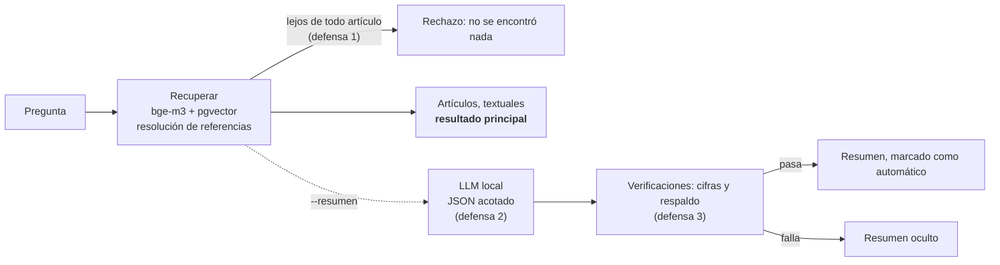

# Norma — RAG local sobre la ley colombiana de protección de datos

[](https://github.com/Juanangara/norma-rag/actions/workflows/tests.yml)

[English](README.md) · **Español**

Haz una pregunta en español corriente ("me pidieron la cédula para un descuento, ¿es legal?") y recibe los **artículos de la ley que la responden, textuales y con su fuente**. Todo corre en un portátil: sin nube, sin claves de API, sin GPU.

Corpus: **Ley 1581 de 2012** (30 artículos) y **Decreto 1074 de 2015, capítulo 25** (35 artículos, que compila el antiguo Decreto 1377 de 2013). Procedencia y verificaciones: [`corpus/SOURCES.md`](corpus/SOURCES.md) (en inglés).

> [!WARNING]
> **Vigencia de la ley.** Hay un proyecto de reforma de la Ley 1581 (Proyecto de Ley Estatutaria 282 de 2026 Cámara, radicado en agosto de 2026) en trámite en el Congreso. A 2026-10-27 ninguna fuente muestra que esté aprobado, pero **no se pudo confirmar su estado oficial** (detalles en [`corpus/SOURCES.md`](corpus/SOURCES.md)). Los textos de este repositorio se verificaron el 2026-10-26; si el proyecto se aprueba, el corpus queda desactualizado. Verifica la ley vigente antes de apoyarte en ella. No es asesoría legal.

Este proyecto estudia hasta dónde se puede confiar en un modelo local pequeño en un dominio legal, y lo que midió es "no mucho": el diseño gira en torno a ese resultado. Las cifras están en [`eval/REPORT.md`](eval/REPORT.md) (en inglés).

## Características
- Preguntas en español corriente; la respuesta son los artículos de la ley, textuales, con norma, número de artículo y título
- Corpus procesado desde textos de copias digitales a JSONL (65 artículos), la fuente de verdad; procedencia y verificaciones documentadas
- Búsqueda semántica con `bge-m3` en PostgreSQL + pgvector (HNSW): artículos divididos por párrafo, un fragmento por definición, referencias explícitas resueltas ("artículo 9 del Decreto 1377" → el artículo que lo reemplazó)
- Las preguntas fuera del alcance se rechazan en lugar de responderse
- Resumen opcional de un LLM local de 1 000 millones de parámetros (llama.cpp), con JSON restringido por gramática y verificaciones contra alucinaciones; se oculta si no las supera
- Línea de comandos y una demo web local
- Evaluación con tres conjuntos de preguntas (uno reservado hasta el final), métricas de recuperación, experimentos con modelos de embeddings, reranker y latencia, y una ablación calificada de cada defensa
- 54 pruebas automáticas e integración continua
- Todo corre en local: Docker, sin claves de API, sin GPU

| Una pregunta que el corpus responde | Una que no |
|---|---|
|  |  |

*Demo web local (`python -m app.web`). La pregunta de la izquierda es fácil; las preguntas de personas sin formación legal se recuperan peor, mira las cifras más abajo.*

## Cómo funciona



- **La recuperación** es el resultado. Búsqueda vectorial sobre fragmentos del tamaño de un artículo (los artículos largos se dividen por párrafo, "Definiciones" un fragmento por definición), más referencias explícitas: "artículo 9 del Decreto 1377" se resuelve al artículo que lo reemplazó (2.2.2.25.2.6).
- **El resumen es opcional y se marca como automático.** El LLM local (Llama 3.2 1B por defecto, intercambiable) responde en JSON acotado; después el sistema busca los párrafos que lo respaldan, rechaza las cifras que no aparecen en lo que se le mostró y rechaza las respuestas que el texto recuperado no cubre.
- **Dice cuándo no sabe**: las preguntas fuera de alcance reciben un rechazo, nunca una respuesta inventada.

## Qué se midió (y qué significa)

| | Resultado |
|---|---|
| Recuperación, preguntas que escribí después de leer el corpus (40) | un artículo esperado entre los 4 primeros: **0.97** |
| Recuperación, 22 preguntas de una persona sin formación legal (desarrollo) | **0.77** (cualquier artículo relevante: 0.86) |
| Recuperación, 20 preguntas de una persona sin formación legal (reservadas, medidas una sola vez) | **0.60** (cualquier artículo relevante: 0.75) |
| `bge-m3` frente a `multilingual-e5-small`, MRR en preguntas sin formación legal (desarrollo / reservadas) | 0.67 frente a 0.30 / 0.55 frente a 0.48 |
| Reranker `bge-reranker-v2-m3` | sin mejora, MRR menor (0.51 frente a 0.67), ~40 s por pregunta en CPU: descartado |
| Híbrido (texto completo en español + vectorial) | no superó a la búsqueda vectorial sola |
| **Modelo de 1B, resúmenes que pasaron todas las verificaciones, reservadas** | **0 de 5 correctos** |

La última fila es la razón por la que el resultado principal es la ley y no el texto generado. En las preguntas reservadas, todos los resúmenes que pasaron las verificaciones estaban mal: invertían el sentido ("es obligatorio contestar todos los datos de salud") o afirmaban lo que el corpus no dice. Las verificaciones sí detienen las invenciones evidentes (una receta, una pena de prisión, una cifra inventada): 20 de 25 respuestas equivocadas bloqueadas en la muestra de desarrollo. No pueden ver un sentido invertido. Detalles, casos de fallo y método (los umbrales se ajustaron solo con respuestas de desarrollo): `eval/REPORT.md`, secciones 7 y 8.

## Un modelo pequeño, y qué se hizo al respecto

El resumen lo escribe **Llama 3.2 1B Instruct, unos 1 000 millones de parámetros, cuantizado a 4 bits (Q4_K_M, 0.8 GB)**, servido con llama.cpp en la CPU de un portátil (i5-1235U, sin GPU, de 3 a 9 tokens por segundo). Es a propósito: la idea era un sistema que cualquiera pueda correr en local. También es un modelo débil. Sigue un prompt de forma laxa, copia en lugar de razonar y dice cosas equivocadas con seguridad. Por eso se trata como un componente que hay que contener, no en el que hay que confiar, y cada defensa de abajo existe por un fallo que se observó y se midió, no que se supuso.

| Lo observado con el modelo de 1B | Lo que hace el sistema |
|---|---|
| Responde a todo, incluso a preguntas fuera de alcance: 0 de 7 rechazos (receta de arepas, pena de prisión, banner de cookies, otras leyes) | **Defensa 1.** Si incluso el mejor artículo está demasiado lejos de la pregunta, no se genera nada y se le dice a la persona. Las referencias explícitas ("artículo 9 del Decreto 1377") se saltan esta verificación: llevan su propia evidencia. |
| Inventa o ignora el texto cuando tiene demasiada libertad | **Defensa 2.** Solo ve los 4 artículos recuperados, con temperatura 0 y reglas para no usar nada más. La respuesta se fuerza con una gramática construida desde un esquema JSON (llama.cpp): longitud acotada, sin salida libre. Una respuesta cortada o mal formada se descarta. |
| Responde un "Sí" o un "No" a secas | El esquema exige una explicación de 80 a 450 caracteres. |
| No copia citas: al pedirle que citara la ley devolvió encabezados de artículos (0 de 8 citas literales) | Ya no cita. Señala códigos de párrafo de una lista fija, y el texto que se muestra sale del corpus. |
| Cita el artículo equivocado: copió de uno y citó otro | Se ignoran las citas del modelo. El sistema encuentra los párrafos que realmente cubren la respuesta y muestra esos. |
| Inventa cifras ("30 días", "10.000 salarios") | **Defensa 3.** Cualquier cifra de la respuesta que no aparezca en los artículos que se le mostraron hace que se rechace. |
| Habla de cosas que los artículos nunca mencionan | **Defensa 3.** Al menos el 60 % de las palabras de contenido de la respuesta deben quedar cubiertas por los tres mejores párrafos, o se rechaza. |
| Se equivoca de todos modos | El texto generado nunca es el resultado principal. Primero va la ley, textual; el resumen es opcional, se marca como automático y se oculta si no supera las verificaciones. Todo resultado lleva el aviso de "no es asesoría legal". |

Cuánto ayudó, calificando cada respuesta leyéndola frente a la respuesta esperada (muestra de desarrollo de 39, casi todos casos difíciles):

| | Mostradas | Equivocadas | Equivocadas bloqueadas | Correctas bloqueadas |
|---|---|---|---|---|
| Sin defensas | 39 | 25 (64 %) | 0 | 0 |
| Defensas 1 y 3 | 17 | 5 (29 %) | 20 de 25 | 2 de 13 |

Tres problemas de mi propio primer diseño se encontraron leyendo las salidas y se corrigieron: un código de ejemplo en el prompt que el modelo copiaba en casi todas las respuestas, etiquetas numéricas que repetía como si fueran contenido, y el "Sí" o "No" a secas.

**Lo que no arregla.** En las 20 preguntas reservadas las defensas bloquearon la mitad de las respuestas equivocadas, pero las 5 que pasaron estaban mal, y las 5 correctas quedaron bloqueadas. Las verificaciones comparan vocabulario, no significado, así que no pueden ver un sentido invertido ("no tienes derecho a borrar tus datos") ni una respuesta que va más allá de lo que dice el corpus. Por eso la ley va primero. Lo que no se ha probado y podría ayudar: un modelo más grande (el de 3B sería unas 3 veces más lento aquí) y un modelo de implicación textual que compruebe si la respuesta se deduce del párrafo citado. Método completo, fallos y cifras: `eval/REPORT.md`, secciones 3, 7 y 8.

## Lo que aprendí

- **Mide con preguntas que no usaste para diseñar.** Las preguntas escritas después de leer el corpus dieron 0.97; las de una persona sin formación legal dieron de 0.60 a 0.77. El conjunto fácil escondía el problema real.
- **Un mejor modelo de embeddings ayudó; las etapas extra del pipeline no.** `bge-m3` superó a `multilingual-e5-small` en preguntas sin formación legal (modestamente en las reservadas); un reranker y la búsqueda híbrida no aportaron nada.
- **Un umbral de similitud no distingue una pregunta respondible de una que no lo es**: las puntuaciones se solapan (mejor fragmento 0.63 para una pregunta a rechazar, 0.48 para una a responder).
- **Una defensa puede verse bien dentro de la muestra y fallar con datos reservados.** Las verificaciones se ajustaron con 39 respuestas; con un conjunto nuevo solo dejaron pasar respuestas equivocadas.
- **Con un modelo pequeño en un dominio serio, muestra la fuente, no la generación.**

## Límites que debes conocer

- **No es asesoría legal.** Todo resultado lo dice. Las etiquetas de los conjuntos de evaluación las propuso el modelo que construyó el sistema y **no las ha revisado un abogado**; 8 están marcadas como `dudoso`. Las respuestas también las calificó ese modelo.
- Los conjuntos de evaluación son pequeños (de 20 a 47 preguntas): una pregunta mueve una puntuación entre 0.02 y 0.05.
- Los textos son copias digitales (SUIN, Función Pública), comparadas entre sí pero no con el Diario Oficial. En agosto de 2026 se radicó un proyecto de reforma (Proyecto de Ley Estatutaria 282 de 2026 Cámara) para modificar la Ley 1581. A 2026-10-27 ninguna fuente muestra que esté aprobado, pero no se pudo confirmar su estado oficial (detalles en `corpus/SOURCES.md`); si se aprueba, el corpus queda desactualizado.
- El Decreto 1377 de 2013 solo se alcanza mediante las equivalencias con el capítulo del Decreto 1074. Otras normas (p. ej. la Ley 1266, habeas data financiero) están fuera de alcance y se rechazan.
- En CPU un resumen tarda de 30 a 95 s; la búsqueda sola tarda mucho menos de un segundo una vez cargado el modelo.

## Trabajo futuro

En orden aproximado de impacto. Nada de esto se ha probado, salvo que se indique.

1. **Revisión de la evaluación por un abogado.** Revisar las etiquetas (primero las 8 marcadas `dudoso`) y ampliar el conjunto de preguntas independientes. Todas las cifras de este repositorio ganan fiabilidad.
2. **Una verificación de implicación textual sobre el resumen.** Un modelo NLI multilingüe que compruebe si la respuesta se deduce del párrafo citado. Apunta al fallo que las verificaciones actuales no ven: un sentido invertido.
3. **Otros modelos pequeños.** Las mismas defensas y el mismo conjunto reservado con Llama 3.2 3B (unas 3 veces más lento aquí), Qwen o Gemma, para ver cuánto del problema es el tamaño del modelo.
4. **Mejor recuperación para preguntas de personas sin formación legal** (cobertura de 0.30 a 0.48 hoy): reescribir la pregunta con vocabulario legal usando el LLM, dividir las preguntas dobles, ajustar el modelo de embeddings con pares pregunta-artículo.
5. **Un corpus más amplio:** Decreto 886 de 2014 (Registro Nacional de Bases de Datos), Decreto 1081 de 2015 y Ley 1266 de 2008 (habeas data financiero), que hoy se rechaza por estar fuera de alcance.
6. **Comparar los textos con el Diario Oficial impreso.** Solo se compararon entre sí dos copias digitales.
7. **Seguir el Proyecto de Ley Estatutaria 282 de 2026** y actualizar el corpus si se aprueba.
8. **Cosas menores:** un Dockerfile de la app para que todo arranque con `docker compose up`; mostrar el resumen en streaming en la demo web.

## Cómo correrlo

Necesita Docker, Python 3.11 y unos 4 GB de RAM libres (6 GB con el resumen). Comprobado en un clon limpio (Windows 11, solo CPU): instalar las dependencias tomó unos 10 minutos, la carga unos 6 (más en la primera vez, que además descarga el modelo de embeddings) y las 54 pruebas pasaron.

```bash
cp .env.example .env                  # define POSTGRES_PASSWORD; MODELS_DIR para el resumen (abajo)
docker compose up -d db
python -m venv .venv && .venv/Scripts/pip install -r requirements.txt   # .venv/bin/pip en Linux/macOS
.venv/Scripts/python -m ingest.build  # corpus/raw -> corpus/articles/*.jsonl (ya incluido)
.venv/Scripts/python -m ingest.load   # divide, calcula embeddings con bge-m3 (la primera vez descarga ~2.3 GB), carga pgvector
.venv/Scripts/python -m app.cli "Mi vecino subió una foto mía a internet sin permiso, ¿es un tema de datos personales?"
```

O abre la página web local (solo biblioteca estándar, ligada a `127.0.0.1`):

```bash
.venv/Scripts/python -m app.web       # luego abre http://127.0.0.1:8765
```

Muestra los artículos más cercanos como tarjetas (primer párrafo visible, el resto plegado), con preguntas de ejemplo y una casilla opcional para el resumen automático.

Para el resumen, apunta `MODELS_DIR` a una carpeta con un archivo GGUF (por defecto `Llama-3.2-1B-Instruct-Q4_K_M.gguf`, ~0.8 GB, de `bartowski/Llama-3.2-1B-Instruct-GGUF` en Hugging Face) y luego:

```bash
docker compose up -d llama
.venv/Scripts/python -m app.cli --resumen "¿Qué es un dato sensible?"
```

Cualquier otro GGUF funciona cambiando `MODEL_FILE`. Cualquier otro modelo de embeddings funciona cambiando `EMBEDDING_MODEL` y repitiendo `ingest.load` (la tabla se recrea con el tamaño de vector del modelo).

## Reproducir la evaluación

```bash
python -m eval.run_retrieval eval/blind.jsonl     # recuperación sobre un conjunto (questions, blind, heldout)
python -m eval.experiments bge-m3 e5-base         # compara modelos de embeddings en memoria (--rerank para el reranker)
python -m eval.latency e5-small                   # tiempo de carga / indexado / consulta y memoria de un modelo
python -m eval.run_answers questions blind        # genera con el LLM local (~1 min por pregunta)
python -m eval.score_answers --detail             # defensas sobre las respuestas guardadas
python -m pytest                                  # 54 pruebas (las de recuperación necesitan la base de datos)
```

`eval/heldout.jsonl` está reservado para la confirmación final: míralo una sola vez, después de elegir.

## Estructura

```
corpus/   textos originales, artículos procesados (JSONL, la fuente de verdad), SOURCES.md
ingest/   procesar → dividir → embeddings → cargar en pgvector
app/      retrieve (vectorial, texto completo, resolución de referencias), generate (JSON acotado), verify, answer, cli, web (+ static/)
eval/     conjuntos de preguntas, puntuación de recuperación y respuestas, experimentos con modelos/reranker, REPORT.md
db/       plantilla del esquema      tests/    pruebas unitarias y de integración
```

## Sobre el corpus

Las leyes de `corpus/` son textos jurídicos públicos; de dónde salió cada copia y cómo se verificó está en `corpus/SOURCES.md`.
