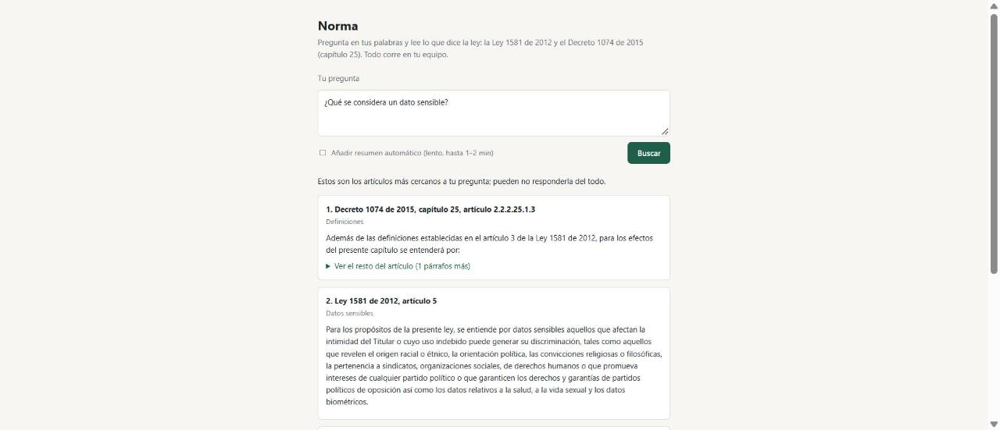
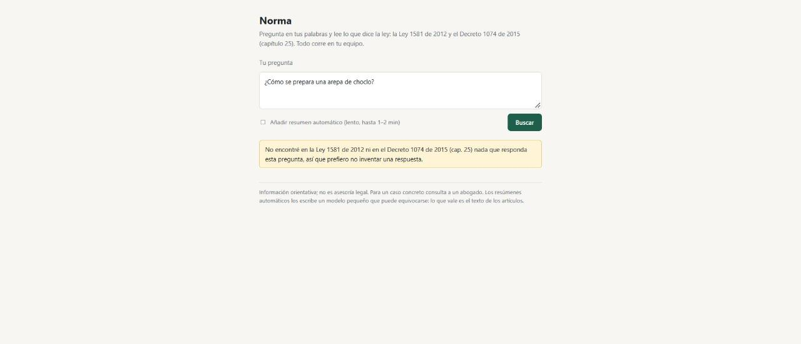
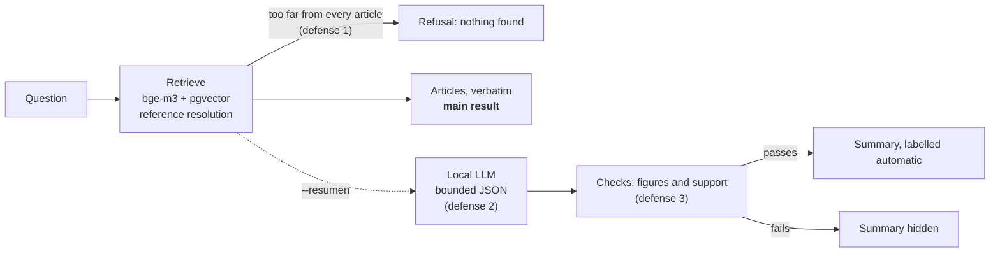

# Norma — local RAG over Colombian personal-data law

[](https://github.com/Juanangara/norma-rag/actions/workflows/tests.yml)

Ask a question in plain Spanish ("me pidieron la cédula para un descuento, ¿es legal?") and get the **articles of the law that answer it, verbatim, with their source**. Everything runs on a laptop: no cloud, no API keys, no GPU.

Corpus: **Ley 1581 de 2012** (30 articles) and **Decreto 1074 de 2015, capítulo 25** (35 articles, which compiles the old Decreto 1377 de 2013). Provenance and checks: [`corpus/SOURCES.md`](corpus/SOURCES.md).

This is a study of how far a small local model can be trusted in a legal domain, and the answer it measured is "not far": the project is built around that result. Read [`eval/REPORT.md`](eval/REPORT.md) for the numbers.

## Features
- Questions in plain Spanish; the answer is the articles of the law, verbatim, with norm, article number and title
- Corpus parsed from official-copy texts into JSONL (65 articles), the source of truth; provenance and checks documented
- Semantic search with `bge-m3` in PostgreSQL + pgvector (HNSW): articles split by paragraph, one chunk per definition, explicit references resolved ("artículo 9 del Decreto 1377" → the article that replaced it)
- Out-of-scope questions are refused instead of answered
- Optional summary from a local 1B-parameter LLM (llama.cpp), with grammar-constrained JSON and checks against hallucination; hidden when it fails them
- Command line and a local web demo
- Evaluation with three question sets (one held out until the end), retrieval metrics, embedding-model, reranker and latency experiments, and a graded ablation of each defense
- 54 automated tests and CI
- Everything runs locally: Docker, no API keys, no GPU

| A question the corpus answers | A question it does not |
|---|---|
|  |  |

*Local web demo (`python -m app.web`). The left question is an easy one; questions from a non-lawyer retrieve worse, see the numbers below.*

## How it works



- **Retrieval** is the result. Vector search over article-sized chunks (long articles are split by paragraph, "Definiciones" one definition per chunk), plus explicit references: "artículo 9 del Decreto 1377" resolves to the article that replaced it (2.2.2.25.2.6).
- **A summary is optional and labelled automatic.** The local LLM (Llama 3.2 1B by default, swappable) answers in bounded JSON; the system then looks for the paragraphs that support it, rejects figures that appear nowhere in what it was shown, and rejects answers the retrieved text does not cover.
- **It says when it does not know**: out-of-scope questions get a refusal, never an invented answer.

## What was measured (and what it means)

| | Result |
|---|---|
| Retrieval, questions I wrote after reading the corpus (40) | an expected article in the top 4: **0.97** |
| Retrieval, 22 questions from a non-lawyer (development) | **0.77** (any relevant article: 0.86) |
| Retrieval, 20 questions from a non-lawyer (held out, scored once) | **0.60** (any relevant article: 0.75) |
| `bge-m3` vs `multilingual-e5-small`, non-lawyer MRR (dev / held-out) | 0.67 vs 0.30 / 0.55 vs 0.48 |
| Reranker `bge-reranker-v2-m3` | no gain, lower MRR (0.51 vs 0.67), ~40 s per question on CPU: discarded |
| Hybrid (Spanish full-text + vector) | did not beat vector alone |
| **1B model, summaries that passed all checks, held-out** | **0 of 5 correct** |

The last row is why the main output is the law and not generated text. On held-out questions every summary that passed the checks was wrong: it reversed the meaning ("answering every health field is obligatory") or asserted what the corpus does not cover. The checks do stop obvious fabrications (a recipe, a prison sentence, an invented figure): 20 of 25 wrong answers blocked on the development sample. They cannot see a reversed meaning. Details, failure cases and the method (thresholds were tuned on development answers only): `eval/REPORT.md`, sections 7 and 8.

## A small model, and what was done about it

The summary comes from **Llama 3.2 1B Instruct, about 1 billion parameters, 4-bit quantized (Q4_K_M, 0.8 GB)**, served by llama.cpp on a laptop CPU (i5-1235U, no GPU, 3 to 9 tokens per second). That is on purpose: the point was a system anyone can run locally. It is also a weak model. It follows a prompt loosely, copies instead of reasoning, and says wrong things with confidence. So it is treated as a component to contain, not to trust, and every defense below exists because of a failure that was observed and measured, not assumed.

| Observed with the 1B model | What the system does about it |
|---|---|
| Answers anything, even out-of-scope questions: 0 of 7 refusals (arepa recipe, prison sentence, cookie banner, other laws) | **Defense 1.** If even the best article is too far from the question, nothing is generated and the person is told so. Explicit references ("artículo 9 del Decreto 1377") skip this check, they carry their own evidence. |
| Invents or ignores the text when it has too much freedom | **Defense 2.** It only sees the 4 retrieved articles, with temperature 0 and rules to use nothing else. The reply is forced by a grammar built from a JSON schema (llama.cpp): bounded length, no free-form output. A reply that is cut off or malformed is discarded. |
| Answers a bare "Sí" or "No" | The schema requires an explanation of 80 to 450 characters. |
| Does not copy quotes: asked to quote the law, it returned article headings (0 of 8 quotes literal) | It no longer quotes. It cites paragraph codes from a fixed list, and the text shown comes from the corpus. |
| Cites the wrong article: it copied from one and cited another | The model's citations are ignored. The system finds the paragraphs that actually cover the answer, and shows those. |
| Invents figures ("30 días", "10.000 salarios") | **Defense 3.** Any figure in the answer that appears nowhere in the articles it was shown rejects the answer. |
| Talks about things the articles never mention | **Defense 3.** At least 60% of the answer's content words must be covered by the best three paragraphs, or it is rejected. |
| Gets it wrong anyway | The generated text is never the main result. The law, verbatim, comes first; the summary is optional, labelled as automatic, and hidden when it fails the checks. Every result carries a "not legal advice" notice. |

How much it helped, graded by reading each answer against its expected answer (development sample of 39, mostly hard cases):

| | Shown | Wrong | Wrong answers blocked | Correct answers blocked |
|---|---|---|---|---|
| No defenses | 39 | 25 (64%) | 0 | 0 |
| Defenses 1 and 3 | 17 | 5 (29%) | 20 of 25 | 2 of 13 |

Three problems in my own first design were found by reading the outputs and fixed: an example code in the prompt that the model copied into almost every answer, numeric labels that it echoed as content, and the bare "Sí" or "No".

**What it does not fix.** On the 20 held-out questions the defenses blocked half of the wrong answers, but all 5 that passed were wrong, and all 5 correct ones were blocked. The checks compare vocabulary, not meaning, so they cannot see a reversed meaning ("no tienes derecho a borrar tus datos") or an answer that goes beyond what the corpus says. That is why the law comes first. What is untested and might help: a larger model (the 3B would be about 3 times slower here) and an entailment model that checks whether the answer follows from the cited paragraph. Full method, failures and numbers: `eval/REPORT.md`, sections 3, 7 and 8.

## What I learned

- **Measure on questions you did not design from.** Questions written after reading the corpus gave 0.97; questions from a non-lawyer gave 0.60 to 0.77. The easy set hid the real problem.
- **A better embedding model helped; extra pipeline stages did not.** `bge-m3` beat `multilingual-e5-small` on non-lawyer questions (modestly on held-out); a reranker and hybrid search gave nothing.
- **A similarity threshold cannot tell an answerable question from an unanswerable one**: the scores overlap (best chunk 0.63 for a question to refuse, 0.48 for one to answer).
- **A defense can look good in-sample and fail on held-out data.** The checks were tuned on 39 answers; on a fresh set they let only wrong answers through.
- **For a small model in a serious domain, show the source, not the generation.**

## Limits you should know

- **Not legal advice.** Every result says so. The labels of the evaluation sets were proposed by the model that built the system and are **not reviewed by a lawyer**; 8 are flagged `dudoso`. The answers were also graded by that model.
- The evaluation sets are small (20 to 47 questions): one question moves a score by 0.02 to 0.05.
- The texts are digital copies (SUIN, Función Pública), compared with each other but not with the Diario Oficial. A reform bill (Proyecto de Ley Estatutaria 282 de 2026 Cámara) was pending when the corpus was fetched; check its status before relying on the text.
- Decreto 1377 de 2013 is reachable only through the equivalences to the Decreto 1074 chapter. Other norms (e.g. Ley 1266, habeas data financiero) are out of scope and refused.
- On CPU a summary takes 30 to 95 s; search alone takes well under a second once the model is loaded.

## Run it

Needs Docker, Python 3.11 and about 4 GB of free RAM (6 GB with the summary). Checked on a clean clone (Windows 11, CPU only): installing the dependencies took about 10 minutes, loading took about 6 (more on the first run, which also downloads the embedding model), and the 54 tests passed.

```bash
cp .env.example .env                  # set POSTGRES_PASSWORD; MODELS_DIR for the summary (below)
docker compose up -d db
python -m venv .venv && .venv/Scripts/pip install -r requirements.txt   # .venv/bin/pip on Linux/macOS
.venv/Scripts/python -m ingest.build  # corpus/raw -> corpus/articles/*.jsonl (already included)
.venv/Scripts/python -m ingest.load   # chunk, embed with bge-m3 (first run downloads ~2.3 GB), load pgvector
.venv/Scripts/python -m app.cli "Mi vecino subió una foto mía a internet sin permiso, ¿es un tema de datos personales?"
```

Or open the local web page (standard library only, bound to `127.0.0.1`):

```bash
.venv/Scripts/python -m app.web       # then open http://127.0.0.1:8765
```

It shows the closest articles as cards (first paragraph visible, the rest folded), with example questions, and an optional checkbox for the automatic summary.

For the summary, point `MODELS_DIR` at a folder with a GGUF file (default `Llama-3.2-1B-Instruct-Q4_K_M.gguf`, ~0.8 GB, from `bartowski/Llama-3.2-1B-Instruct-GGUF` on Hugging Face), then:

```bash
docker compose up -d llama
.venv/Scripts/python -m app.cli --resumen "¿Qué es un dato sensible?"
```

Any other GGUF works by changing `MODEL_FILE`. Any other embedding model works by changing `EMBEDDING_MODEL` and re-running `ingest.load` (the table is recreated with the model's vector size).

## Reproduce the evaluation

```bash
python -m eval.run_retrieval eval/blind.jsonl     # retrieval on a set (questions, blind, heldout)
python -m eval.experiments bge-m3 e5-base         # compare embedding models in memory (--rerank for the reranker)
python -m eval.latency e5-small                   # load / index / query time and memory of a model
python -m eval.run_answers questions blind        # generate with the local LLM (~1 min per question)
python -m eval.score_answers --detail             # defenses on the cached answers
python -m pytest                                  # 54 tests (retrieval tests need the database)
```

`eval/heldout.jsonl` is reserved for final confirmation: look at it once, after choosing.

## Layout

```
corpus/   raw texts, parsed articles (JSONL, the source of truth), SOURCES.md
ingest/   parse → chunk → embed → load into pgvector
app/      retrieve (vector, full-text, reference resolution), generate (bounded JSON), verify, answer, cli, web (+ static/)
eval/     question sets, retrieval and answer scoring, model/reranker experiments, REPORT.md
db/       schema template      tests/    unit and integration tests
```

## About the corpus

The laws in `corpus/` are public legal texts; where each copy came from and how it was checked is in `corpus/SOURCES.md`.
